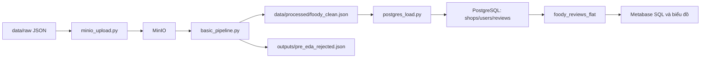

# Kiến trúc Docker và pipeline dữ liệu



Python chạy trên máy với Python 3.10 trở lên; `.venv` hiện dùng Python 3.12.
Compose chạy MinIO, PostgreSQL 16 và Metabase. Đây là ETL pre-EDA theo
`db_schema_pre_eda.md`: lưu dữ liệu crawl đã làm sạch, không tạo feature modeling.
Hợp đồng cột ở `src/processing/foody/schema.py`; SQL ở `configs/postgres_schema.sql`.

## Chạy từ thư mục gốc project

```powershell
docker compose up -d
.\.venv\Scripts\python.exe -m src.processing.foody.basic_pipeline
.\.venv\Scripts\python.exe -m src.ingestion.postgres_load
```

Bước thứ nhất đọc toàn bộ JSON trong bucket `foody-raw-data`, xuất dữ liệu sạch.
Bước thứ hai chỉ đọc file sạch rồi nạp DB; không gọi lại MinIO. File loader tên
`postgres_load.py`. Cũng có thể chạy `python basic_pipeline.py` trong thư mục
`src/processing/foody` và `python postgres_load.py` trong `src/ingestion` sau khi
activate `.venv`. Cả hai script có `--help`; tùy chọn `--output` của pipeline
phải khớp `--input` của loader nếu đổi vị trí file sạch.

Upload khi có raw mới (đường dẫn tương đối từ data/raw):

```powershell
.\.venv\Scripts\python.exe -m src.ingestion.minio_upload --file 30-09-2026/foody_merged_dataset.json
```

`.env` cần `POSTGRES_DB`, `POSTGRES_USER`, `POSTGRES_PASSWORD`,
`MINIO_ROOT_USER`, `MINIO_ROOT_PASSWORD`. Tùy chọn:
`POSTGRES_HOST=localhost`, `POSTGRES_PORT=5432`, `MINIO_ENDPOINT=localhost:9000`,
`MINIO_RAW_BUCKET=foody-raw-data`. Python chạy trong mạng Compose dùng host
`postgres` và endpoint `minio:9000`.

## Quy tắc làm sạch và nạp

- `review_id` là khóa BIGSERIAL do DB cấp; `source_review_id` giữ ID Foody gốc,
  cho phép NULL để giữ dữ liệu crawler cũ ngày 28/09.
- `user_pseudo_id = lower(trim(user_name))`; giữ tên hiển thị trong `user_name`.
  Đây là định danh theo tên, có thể gộp những người khác nhau trùng tên.
- Có ID nguồn: loại trùng theo ID. Thiếu ID: loại trùng theo quán, user, thời gian
  và nguyên văn bình luận. Hai ID nguồn khác nhau luôn được giữ riêng.
  Record không ID khớp đúng một ID nguồn được gộp; khớp nhiều ID thì giữ riêng.
- Index khóa tự nhiên dùng MD5 nội dung để hỗ trợ bình luận dài; nội dung DB
  được giữ đầy đủ. Loader kiểm tra xung đột hash giữa các nội dung khác nhau và
  rollback thay vì gộp. Không tạo cột feature hash.
- Metadata quán lấy giá trị không NULL mới nhất theo thời gian upload. Thống kê
  quán và các điểm thành phần được lấy nguyên từ crawl, không tính lại từ reviews.
  URL quán được lưu trong `shop_url` theo yêu cầu giữ tất cả trường crawl.
- Thời gian bình luận bỏ dấu phẩy cuối từ crawler cũ. TIMESTAMP dùng giờ Việt Nam
  không timezone; `crawled_at`/`last_crawled_at`/`first_seen_at` là thời điểm ETL
  quan sát dữ liệu vì JSON không có thời điểm crawl nguồn.
- Bắt buộc quán, thành phố, user, rating 0..10, thời gian và bình luận. Record
  vi phạm ràng buộc, giá đảo ngược hoặc trường nguồn chưa có mapping được cách ly
  với nguyên vẹn raw record và lý do trong `outputs/pre_eda_rejected.json`.
  Không tự bịa giá/rating hoặc âm thầm bỏ cột mới. JSON raw trên MinIO được giữ.
- Không sinh comment_hour, độ dài, emoji count, điểm LLM, label hay số review/user.
- Một transaction nạp shops → users → reviews; lỗi rollback cả lần nạp.
  Chạy lại UPSERT giữ khóa surrogate và không tăng record trùng; dữ liệu thiếu
  không xóa metadata đang có. Nâng record không ID lên ID nguồn khi khớp rõ ràng.
  Schema cũ không khớp cột sẽ bị từ chối, không tự DROP dữ liệu.

## Kiểm thử

```powershell
.\.venv\Scripts\python.exe -X utf8 -m unittest discover -s tests -v
```

Test PostgreSQL chạy khi cấu hình `ETL_TEST_POSTGRES_DSN`, mỗi test tạo/dọn một
schema riêng `etl_test_*`. Không có DSN thì sáu test tích hợp được skipped.
Xem `reports/pipeline_schema_review.md` để đọc số liệu và đối chiếu trường nguồn.

## Viết SQL và xem biểu đồ bằng Metabase

Chạy từ thư mục gốc project:

```powershell
docker compose up -d metabase
docker compose ps metabase
```

Compose sẽ khởi động PostgreSQL nếu chưa chạy và tải image Metabase nếu chưa
có trên máy. Lỗi `EOF` lúc pull image nghĩa là kết nối tải xuống bị ngắt;
Compose vẫn cần tải cùng image. Có thể thử lại bằng `docker compose pull metabase`,
sau đó `docker compose up -d metabase`.

Nếu Docker Desktop liên tục báo EOF nhưng HTTPS từ Windows vẫn hoạt động,
project có script tải image từ registry Docker Hub chính thức qua máy host,
kiểm tra SHA-256 từng blob và lớp giải nén, rồi nạp bằng `docker load`:

```powershell
.\.venv\Scripts\python.exe -X utf8 docker/metabase/fetch_image.py
docker compose up -d --pull never metabase
```

Script lấy đúng kiến trúc Linux của Docker server và giữ cache có thể tải tiếp
trong `outputs/metabase_image_cache` (đã được gitignore). Lệnh `--pull never`
dùng image vừa nạp; PostgreSQL image cũng cần có sẵn trên máy.
Compose cố định Metabase `v0.63.19` với `pull_policy: missing`, để các lần
khởi động tiếp theo dùng image đã có trên máy và không tự tải lại tag latest.

Xác minh ngày 01/10/2026: Metabase healthy, `/api/health` trả HTTP 200 và
PostgreSQL đăng nhập được bằng cấu hình `.env`. Thư mục `docker/db/pg_data`
ban đầu chỉ chứa 14 thư mục rỗng, không có file; đã giữ lại nguyên trạng ở
`docker/db/pg_data_incomplete_20261001` trước khi khởi tạo cluster hợp lệ.
Pipeline pre-EDA đã nạp ba bảng shops/users/reviews và view foody_reviews_flat.
Khi có dữ liệu mới, chạy lại hai bước ETL ở phần trên trước khi tạo biểu đồ.

Mở http://localhost:3000, tạo tài khoản quản trị và thêm nguồn dữ liệu PostgreSQL:

| Cấu hình | Giá trị |
|---|---|
| Host | `postgres` (tên service trong mạng Compose) |
| Port | `5432` |
| Database name | Giá trị `POSTGRES_DB` trong `.env` |
| Username | Giá trị `POSTGRES_USER` trong `.env` |
| Password | Giá trị `POSTGRES_PASSWORD` trong `.env` |

Metabase trong Compose truy cập DB qua host `postgres`. Chọn New → SQL query,
chạy SELECT rồi chọn Visualization để vẽ biểu đồ hoặc lưu vào dashboard.
Query và dashboard được giữ trong volume `metabase_data`, dùng cùng tên
volume ở lệnh docker run trước đó. `MB_DB_FILE` là database nội bộ của Metabase
để lưu cấu hình và dashboard; nguồn dữ liệu phân tích PostgreSQL được thêm
riêng trong giao diện setup. Healthcheck dùng endpoint `/api/health`.

Theo [hướng dẫn Docker của Metabase](https://www.metabase.com/docs/latest/installation-and-operation/running-metabase-on-docker),
file H2 có volume phù hợp cho sử dụng local; khi vận hành production, chuyển
database nội bộ Metabase sang PostgreSQL riêng.
